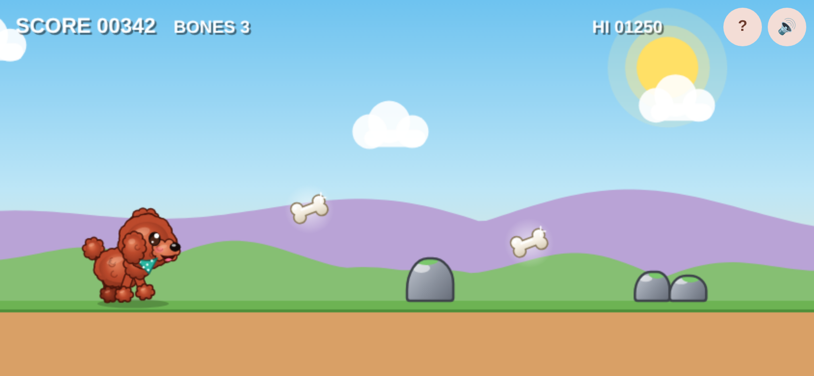
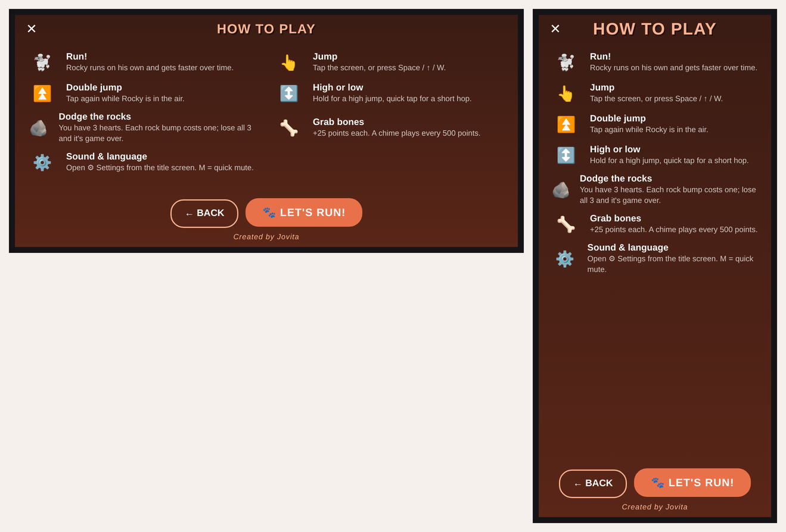
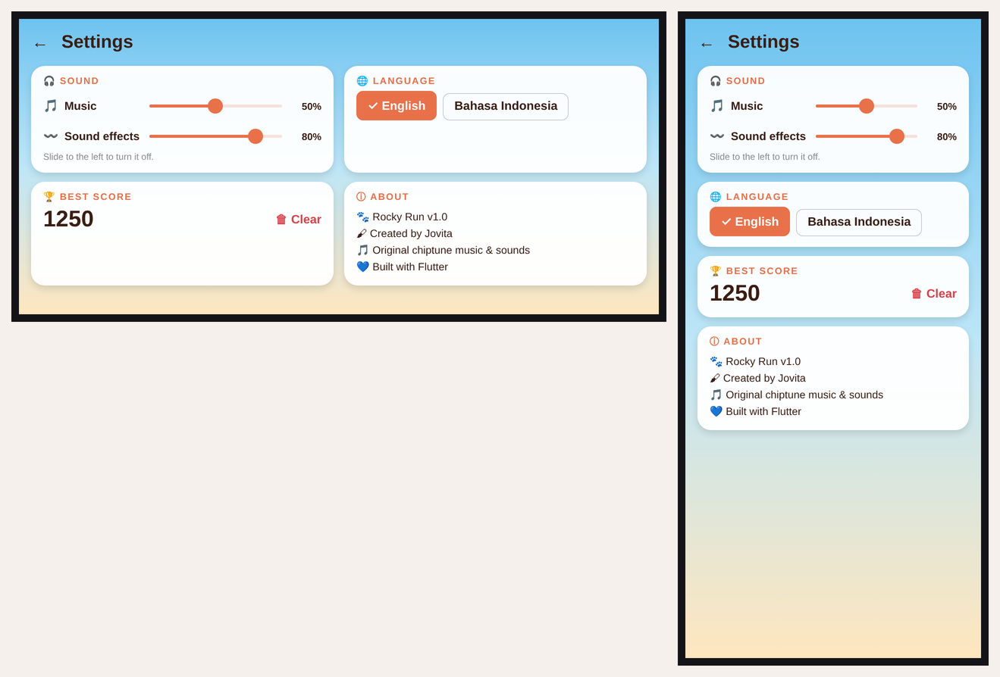

# Rocky Run 🐩

An endless runner starring **Rocky**, a red toy poodle. Jump over rocks, grab bones, keep your 3 hearts, beat your best score.
Built with Flutter for **Android**, **Web** and **Windows**. Created by Jovita.



## Features
- Hand-drawn vector art (no image assets for gameplay): Rocky, rocks, bones, parallax hills
- Tap / Space to jump, double jump, hold for higher jumps
- 3 hearts with short invincibility after a hit, bones worth +25, milestone chime every 500 points
- Original chiptune music and sound effects (generated by `tools/gen_audio.py`)
- How to Play page before every run, Settings page (music / sound volume, English / Bahasa Indonesia, best score, about)
- Works in landscape and portrait; phone-friendly wording and Android Back button support
- Custom app icon for Android (adaptive), Windows and Web

| How to Play | Settings |
| --- | --- |
|  |  |

## Run it
```bash
flutter pub get
flutter run            # pick Chrome, Windows or an Android device
```

## Build a release
```bash
flutter build apk --release   # Android APK  -> build/app/outputs/flutter-apk/app-release.apk
flutter build web --release   # Website      -> build/web
```
Full step-by-step instructions (signing key, Netlify, GitHub Pages, troubleshooting): [docs/Rocky_Run_Release_Guide.pdf](docs/Rocky_Run_Release_Guide.pdf)

## Project structure
```
lib/main.dart                     game screen: world, score bar, title & game-over cards
lib/game.dart                     game state, physics, spawning, collisions, hearts
lib/painters.dart                 sky / hills / ground / rocks / bones + the Rocky sprite
lib/game_audio.dart               sound effects + looping music
lib/strings.dart                  English / Indonesian text, keyboard vs touch wording
lib/pages/how_to_play_page.dart   How to Play page
lib/pages/settings_page.dart      Settings page
lib/ui/                           shared colours, styles and small art icons
assets/audio/                     music and sound effects (.wav)
assets/icon/                      app icon source images (1024 px)
tools/gen_audio.py                regenerates all audio (needs numpy)
```

## Controls
| Action | Phone | Keyboard |
| --- | --- | --- |
| Jump / start | Tap | Space, ↑, W |
| Double jump | Tap again in the air | Press again in the air |
| How to Play / Settings | ? / ⚙ buttons | H / S |
| Mute | Speaker button | M |
| Back to title | Phone Back button | Esc |
