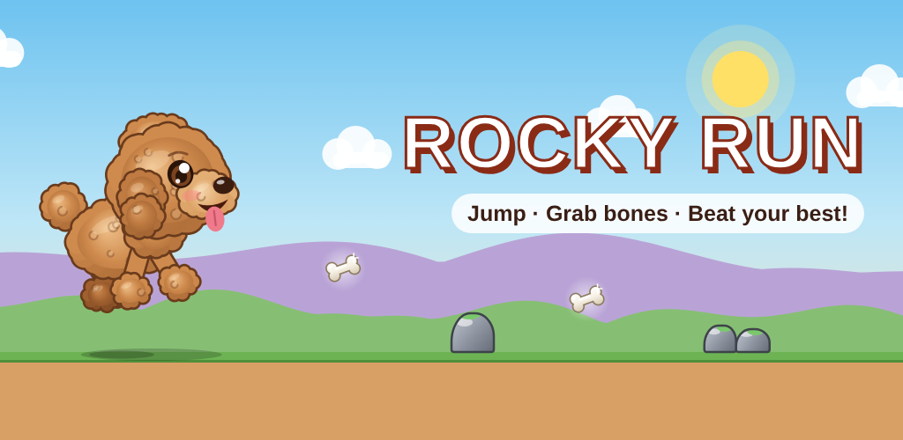
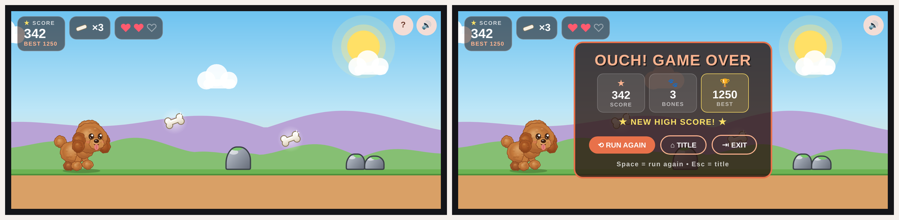
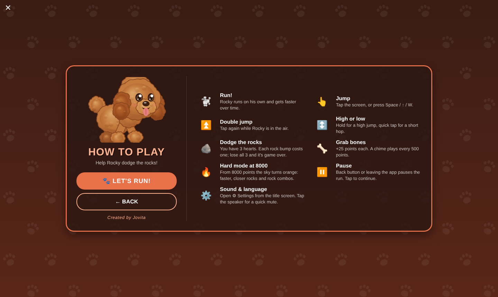
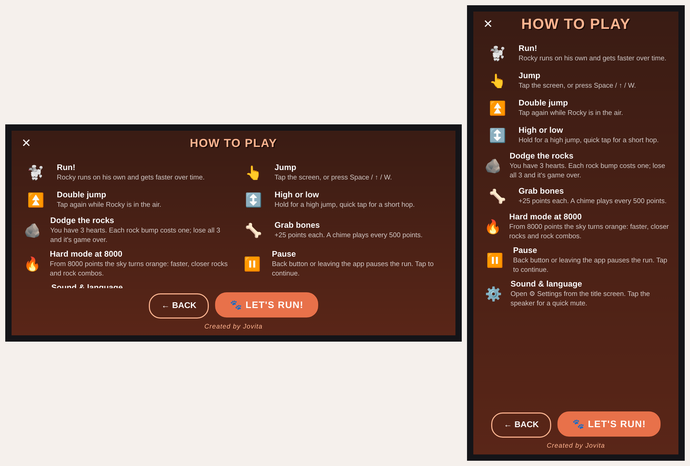
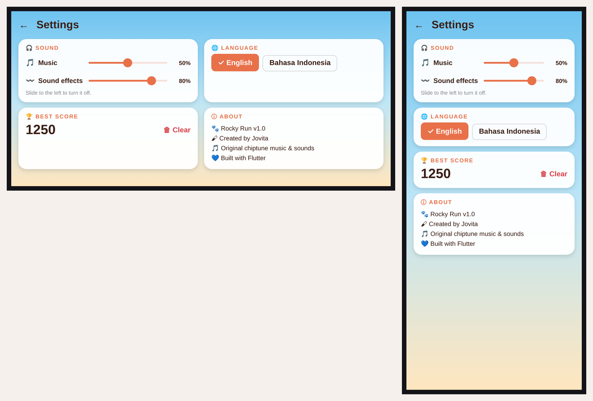

# Rocky Run 🐩

An endless runner starring **Rocky**, a fluffy caramel toy poodle. Jump over rocks, grab bones, keep your 3 hearts and beat your best score.
Built with Flutter for **Android**, **Web** and **Windows**. Created by Jovita.

🎮 **Play online:** https://rockyrunwafel.netlify.app



## Features
- **Rocky**: curly caramel toy poodle drawn in code (or your own painted frames, see [Custom Rocky art](#custom-rocky-art)), with run, jump, idle-blink and crash animations
- **Controls**: tap / Space to jump, tap again for a double jump, hold for a higher jump
- **3 hearts** with short invincibility after a hit; bones worth **+25**; a chime every **500** points
- **Hard mode at 8000 points**: sunset sky, higher speed, tighter rock gaps and back-to-back rock combos
- **Pause**: the Back button (or Esc), switching apps or hiding the browser tab pauses the run; tap to continue
- **Modern original audio**: plucked guitar, marimba, pad and drums loop plus polished sound effects, all generated by `tools/gen_audio.py` (no samples)
- **How to Play** guide before every run, **Settings** page (music / sound volume, English / Bahasa Indonesia, best score, about)
- Landscape and portrait, phone-friendly wording, iPhone Safari optimisations (no zoom / scroll, instant Web Audio sound effects)
- Custom app icon for Android (adaptive), Windows and Web; Play Store ready (package `com.jovita.rockyrun`, target API 36)

## How to Play guide

**PC / web (wide screen)**



**Phone (landscape and portrait)**



| Rule | What it means |
| --- | --- |
| Run! | Rocky runs on his own and gets faster over time |
| Jump | Tap anywhere (PC: Space / ↑ / W) |
| Double jump | Tap again while Rocky is in the air |
| High or low | Hold for a high jump, quick tap for a short hop |
| Dodge the rocks | 3 hearts; each rock bump costs one, lose all 3 and it's game over |
| Grab bones | +25 points each; a chime every 500 points |
| Hard mode at 8000 | Sky turns orange: faster, closer rocks and rock combos |
| Pause | Back button or leaving the app pauses the run; tap to continue |
| Sound & language | ⚙ Settings on the title screen; speaker button for a quick mute |

## Controls
| Action | Phone | Keyboard |
| --- | --- | --- |
| Jump / start | Tap | Space, ↑, W |
| Double jump | Tap again in the air | Press again in the air |
| Pause / back | Phone Back button | Esc |
| How to Play / Settings | ? / ⚙ buttons | H / S |
| Mute | Speaker button | M |

## Settings



## Run it
```bash
flutter pub get
flutter run            # pick Chrome, Windows or an Android device
```

## Build a release
```bash
flutter build appbundle --release   # Google Play -> build/app/outputs/bundle/release/app-release.aab
flutter build apk --release         # Android APK -> build/app/outputs/flutter-apk/app-release.apk
flutter build web --release         # Website     -> build/web (deploy to Netlify)
```

## Guides
| Guide | What's inside |
| --- | --- |
| [Release Guide (PDF)](docs/Rocky_Run_Release_Guide.pdf) | APK + signing key, website on Netlify / GitHub Pages, release checklist, troubleshooting |
| [Play Store listing](docs/play_store_listing.md) | Store texts (EN / ID), graphics, App content answers, release steps |
| [Store graphics](docs/store/) | 512 × 512 icon and 1024 × 500 feature graphic |
| [Privacy policy](https://rockyrunwafel.netlify.app/privacy.html) | No data collected; best score and settings stay on the device |

Signing key for Google Play (one time): `powershell -ExecutionPolicy Bypass -File tools\create_upload_key.ps1`

## Custom Rocky art
Put painted frames (Rocky facing right, plain background) named `run_1` … `run_4`, `jump`, `idle_1`, `idle_2`, `hurt` in a folder and run:
```bash
python tools/prepare_sprites.py <folder>
```
They are cleaned up and saved to `assets/sprites/`; the game uses them automatically instead of the drawn Rocky.

## Project structure
```
lib/main.dart                     game screen: world, score bar, title / pause / game-over cards, back button
lib/game.dart                     game state, physics, spawning, collisions, hearts, hard mode
lib/painters.dart                 sky / hills / ground / rocks / bones + the drawn Rocky
lib/rocky_sprites.dart            optional painted Rocky frames (assets/sprites/)
lib/game_audio.dart               sound effects + looping music
lib/web_sfx*.dart                 Web Audio sound effects + tab-visibility hook (web only)
lib/strings.dart                  English / Indonesian text, keyboard vs touch wording
lib/pages/how_to_play_page.dart   How to Play guide (wide-screen panel + phone layout)
lib/pages/settings_page.dart      Settings page
lib/ui/                           shared colours, styles and small art icons
assets/audio/                     music and sound effects (.wav)
assets/icon/                      app icon source images (1024 px)
tools/gen_audio.py                regenerates all audio (needs numpy)
tools/prepare_sprites.py          prepares painted Rocky frames
tools/create_upload_key.ps1       creates the Google Play upload key
web/privacy.html                  privacy policy page
```
